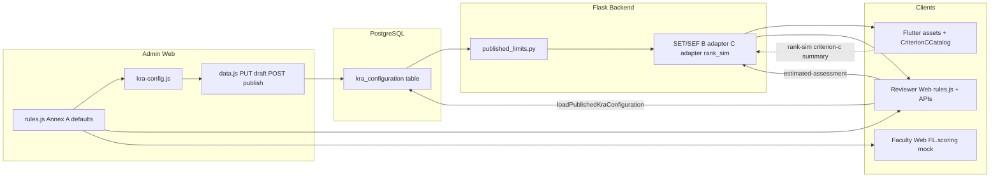

# Phase C4 — Admin Dynamic Scoring Configuration (Read-Only Audit)

**Date:** 2026-11-03  
**Scope:** Admin Official Scoring Configuration → Flask backend → Faculty Mobile (Flutter) → Reviewer Web → Rank Upgrade Simulation  
**Constraint:** Audit only — no code, database, or scoring changes were made.

---

## 1. Executive Summary

FacultyLink already has a **PostgreSQL-backed Official Scoring Configuration** with **draft**, **published**, and **superseded** rows, Admin HTTP APIs, and a working Admin UI that persists drafts and publishes new immutable versions. The **Flask backend scoring engine** (Criterion A SET/SEF, Criterion B bundles, Criterion C per-service accumulation, KRA/criterion caps, rank simulation) **reads the latest published configuration** at calculation time via `get_published_row()` / `published_settings_blob()`.

**However, clients and several server modules still duplicate Annex A values in source code.** Published Admin changes **do not automatically propagate** to Faculty Mobile or to much of the Reviewer/Faculty Web display layer without either reloading published config into `rules.js` or shipping new app assets. Faculty Mobile uses **hardcoded** `CriterionCCatalog` and **static** `assets/kra_catalog.json` (names only, no dynamic points).

| Consumer | Uses published DB config for calculations? | Updates without redeploy? |
|---|---|---|
| Flask backend (rank sim, C/B/C adapters, SET/SEF) | **Mostly yes** (with code fallbacks) | **Yes** after Admin publish (no redeploy) |
| Reviewer Web (live PostgreSQL paths) | **Mixed** — totals via API; labels/points often via `rules.js` | **Partial** — reload published KRA on reviewer pages that call `loadPublishedKraConfiguration()` |
| Faculty Mobile | **Backend APIs yes** for summaries/simulation; **UI catalog no** | **Partial** — simulation/summary refresh; **mobile rebuild** needed for catalog display |
| Faculty Web (browser) | **Mock scoring** via `FL.scoring` + `rules.js`; live admin/reviewer use backend assessment | **No** for faculty-facing mock paths |

**Bottom line:** Admin publish **can** change backend official scoring **without source edits**, but **only where the backend reads `kraSettings.indicators` / `criteria` / `kras`**. Criterion C **per-indicator points** are dynamic on the backend when present in published JSON; the **criterion cap of 10** is still **hardcoded** in `criterion_c_evidence/scoring.py`. Mobile and Web **must not be assumed** to match published config until they fetch and apply the same blob.

---

## 2. Current Admin Scoring Architecture

### 2.1 UI and entry point

| Item | Location |
|---|---|
| Admin page | `web/pages/admin/kra-configuration.html` |
| Shared UI | `web/js/kra-config.js` (renders from `FL.rules`, merges draft overrides) |
| Canonical Annex A template (client) | `web/js/rules.js` (`FL.rules.kras`, `scoreDraft()`, `applySettings()`) |
| Store / API wiring | `web/js/data.js` (`loadKraConfigurationDraft`, `saveKraDraft`, `publishKraConfiguration`, `loadPublishedKraConfiguration`) |

**Behavior:**

- Admin edits indicator **points**, **maxPoints**, **multipliers** (SET/SEF), criterion/KRA **maxPoints**, metadata (`indicatorMeta`), evaluation coverage, effective dates, guideline label.
- Draft is built from `FL.rules.scoreDraft()` merged with saved overrides (`kra-config.js` → `mergeSettingsPayload`).
- **Reviewer read-only** view uses the same UI with `editable: false` and loads published config via `GET /api/reviewer/kra-configuration`.

### 2.2 Storage

| Item | Detail |
|---|---|
| Table | `kra_configuration` (`backend/models.py` → `KraConfiguration`) |
| Columns | `guideline_label`, `status`, `published_at`, `rank_weights` (JSON), `settings_json` (JSON), timestamps |
| Status values | `draft`, `published`, `superseded` (`kra_configuration/service.py`) |
| Not hardcoded in app code for production scoring | Values live in PostgreSQL when published |

**Read-only DB snapshot (audit environment):** published row `id=6`, `version=5`, `effectiveFrom=2023-08-01`, **140** indicators, **14** criteria, KRA rows for `kra1`–`kra4`. Criterion C indicators (e.g. `kra1-c-adviser-sp`) stored as `{ points: 3, maxPoints: 3 }`; criterion `kra1-c` max **10**.

### 2.3 Draft / publish / history

| Capability | Implemented? | Evidence |
|---|---|---|
| Single draft row (latest by `updated_at`) | Yes | `get_draft_row()` |
| Publish creates **new** row, marks prior `published` → `superseded` | Yes | `publish_draft()` |
| Monotonic `version` on publish | Yes | `next_configuration_version()` + body override |
| `effectiveFrom` required to publish | Yes | `validate_publish_payload()` / `assess_publish_readiness()` |
| `effectiveTo` stored if provided | Yes | merged in publish payload |
| Historical versions list / fetch by id | Yes | `GET .../versions`, `GET .../versions/<id>` |
| **Active config by effective date** | **No** | `get_published_row()` = latest `published` by `published_at`, **ignores** `effectiveFrom` / future dating |
| Draft removed on publish | **No** | Draft row `id=1` coexists with published `id=6` in audit DB |
| Audit log on publish/save draft | **No** | `publish_draft()` / `save_draft()` do not write `AuditLog` (contrast: `estimated_score_service.record_estimated_score_audit` logs `scoringConfigurationVersion` on KRA recalc) |

### 2.4 Authorization

| Route prefix | Role |
|---|---|
| `/api/admin/kra-configuration/*` | `ROLE_ADMINISTRATOR` + active admin user check (`kra_configuration/routes.py`) |
| `/api/reviewer/kra-configuration` | `ROLE_REVIEWER` read-only published payload |

Unauthorized roles cannot call Admin mutating endpoints (Flask-JWT + `roles_required`).

### 2.5 Publish validation (official vs configurable)

On publish, `apply_verified_scoring_to_settings()` (`kra_configuration/verified_scoring.py`) **injects verified SET/SEF metadata** (aggregation method, formula reference, `officialFormulaVerified: true`) when validation passes. Gates include:

- SET/SEF indicator max/multiplier present  
- Evaluation coverage valid  
- Criterion A max ≥ SET + SEF maxima  
- **Effective date** required  

**There is no publish-time validation** that Criterion B/C (or KRA II–IV) indicator points match JC 01 Annex A — Admin **can** persist different point values in draft/published JSON. Guideline label is stored (`guideline_label`) but not enforced against point edits.

---

## 3. Database and API Findings

### 3.1 Admin APIs

| Method | Path | Purpose |
|---|---|---|
| GET | `/api/admin/kra-configuration/draft` | Draft + published summary |
| PUT | `/api/admin/kra-configuration/draft` | Save draft (`kraSettings` required) |
| POST | `/api/admin/kra-configuration/validate-publish` | Non-destructive readiness |
| POST | `/api/admin/kra-configuration/publish` | Publish draft → new published row |
| GET | `/api/admin/kra-configuration/published` | Full published payload |
| GET | `/api/admin/kra-configuration/versions` | History summaries |
| GET | `/api/admin/kra-configuration/versions/<id>` | Historical full payload |

Blueprint: `backend/factory.py` registers `kra_config_admin_bp` at `/api/admin`.

### 3.2 Reviewer API

| Method | Path | Purpose |
|---|---|---|
| GET | `/api/reviewer/kra-configuration` | Published `kraSettings` + metadata |

### 3.3 Faculty / scoring APIs (consume published config)

| Area | Endpoints / modules |
|---|---|
| Rank simulation | `GET /api/faculty/me/rank-simulation` → `faculty/rank_simulation_engine.py` |
| Reviewer estimated assessment | `GET /api/reviewer/faculty/:id/estimated-assessment` → `estimated_score_service.estimated_assessment_payload()` |
| Criterion A SET/SEF | `documents/scoring/set_sef_aggregate.py`, `config_loader.indicator_scoring_config()` |
| Criterion B | `kra_configuration/criterion_b_scoring.py`, simulation adapter |
| Criterion C | `kra_configuration/criterion_c_annex.published_points_for_indicator()`, `documents/criterion_c_evidence/scoring.py` |
| Criterion C faculty/reviewer reads | `/api/faculty/me/documents/criterion-c/*`, `/api/reviewer/me/faculty/:id/criterion-c/*` |

**No** `GET /api/faculty/kra-configuration` (or equivalent) for Mobile/Web faculty clients.

### 3.4 Legacy / mock path

`GET /api/state` returns `kraSettings` only in **`web/js/mock-api.js`** (localStorage demo). Live Flask backend **does not** implement `/api/state` (`backend/docs/API_CONTRACT.md` notes split endpoints). Faculty Web `FL.store.load()` still calls `/api/state` — in live mode, **kraSettings are not loaded from PostgreSQL** unless Admin/Reviewer KRA loaders run.

---

## 4. End-to-End Scoring Data Flow

**Legend:** Solid lines = verified integration. Dotted = API-backed calculations but UI may still use hardcoded catalogs.

---

## 5. KRA I Criterion A / B / C Findings

### 5.1 Criterion A (Teaching effectiveness — SET/SEF)

| Aspect | Classification | Notes |
|---|---|---|
| SET/SEF multipliers & maxima | **FULLY DYNAMIC** (if published) | `documents/scoring/config_loader.py` → `indicator_scoring_config()` reads published indicators `kra1-a-student`, `kra1-a-supervisor` |
| Aggregation (OSETR/OSEFR, divisor) | **FULLY DYNAMIC** when `setSefScoring.officialFormulaVerified` | Publish path sets verified metadata; runtime refuses incomplete config |
| Criterion A cap | **FULLY DYNAMIC** | `published_criterion_max_points("kra1-a", settings)` |
| Faculty Mobile display | **PARTIALLY DYNAMIC** | Fetches teaching effectiveness / Criterion A summary from backend (`api_client.dart` comments); not driven by local catalog points |
| Reviewer Web | **PARTIALLY DYNAMIC** | Live teaching-effectiveness APIs; UI copy references published config (`evidence-workspace.js`) |
| Client-side mock scoring | **HARDCODED + optional overrides** | `FL.scoring` + `rules.js`; overrides only if `store.kraSettings` populated |

Historical reviewer-assessed SET/SEF: stored on documents / teaching evaluation records; aggregation recomputes from stored ratings using **current** published multipliers unless documents retain frozen verified points.

### 5.2 Criterion B (Curriculum / materials)

| Aspect | Classification | Notes |
|---|---|---|
| Base points per annex row | **FULLY DYNAMIC** (with annex mapping) | `published_base_points_for_annex_row()` reads published `indicators[base_indicator_id].points` |
| Criterion max / KRA I cap | **FULLY DYNAMIC** | `published_criterion_b_max()`, `cap_kra1_instruction_total()` |
| Rank/KRA aggregation | **FULLY DYNAMIC** when adapter enabled | `CRITERION_B_SIMULATION_ADAPTER_ENABLED` (default on unless env off) |
| Reviewer assessed scores | **Preserved** | Bundle `reviewerAssessment` / document `verified_points` / `reviewer_score` used before recomputation from rules |
| Reviewer Web | **PARTIALLY DYNAMIC** | Workspace uses backend bundle scoring; simple review shows `publishedBasePoints` from API |
| Faculty Mobile | **PARTIALLY DYNAMIC** | Track screens show backend estimates; catalog still static |

### 5.3 Criterion C (Research advising / mentorship) — Phase C1–C3

**Annex A reference values (audit checklist):**

| Rule | Published DB (audit) | Backend resolution | Hardcoded duplicates |
|---|---|---|---|
| SP/CP Adviser 3 | `kra1-c-adviser-sp` → 3 | `published_points_for_indicator()` | `criterion_c_annex.ANNEX_A_DEFAULT_POINTS`, `rules.js`, `CriterionCCatalog` |
| SP/CP Panel 1 | yes | same | same |
| UT Adviser 5 | yes | same | same |
| UT Panel 1 | yes | same | same |
| MT Adviser 8 | yes | same | same |
| MT Panel 2 | yes | same | same |
| DD Adviser 10 | yes | same | same |
| DD Panel 2 | yes | same | same |
| Mentorship 3 | yes | same | same |
| Criterion C max 10 | `criteria.kra1-c.maxPoints: 10` | **Cap in scoring uses `CRITERION_C_MAX_POINTS = 10.0` constant**, not `published_criterion_max_points("kra1-c")` | `criterion_c_annex`, `criterion_c_evidence/scoring.py`, `criterion-c-workspace-ui.js` `MAX_POINTS: 10`, `CriterionCCatalog.maxPoints` |

**Backend (Phase C1):**

- **PARTIALLY DYNAMIC** — per-indicator points from published JSON, fallback `ANNEX_A_DEFAULT_POINTS` (`kra_configuration/criterion_c_annex.py`).
- Aggregation: per-service sum with cap (`documents/criterion_c_evidence/scoring.py`); rank sim via `criterion_c_simulation_adapter.py` (env `CRITERION_C_SIMULATION_ADAPTER_ENABLED`, default on).
- Legacy documents without bundles: best-per-indicator via `effective_document_points()` (may reflect old OCR/reviewer fields, not recomputed from published base).

**Faculty Mobile (Phase C2):**

- **PARTIALLY DYNAMIC** — `GET .../criterion-c/summary` and accomplishments use backend published settings for totals/eligible points.
- **HARDCODED** — `mobile/lib/data/criterion_c_catalog.dart` (`officialPointsForIndicator`, wizard labels); `assets/kra_catalog.json` has indicator **names only** (no points).

**Reviewer Web (Phase C3):**

- **PARTIALLY DYNAMIC** — Summary/accomplishments/scoring from Flask APIs (`criterion-c-evidence.js`, enriched document serializer).
- **HARDCODED display fallback** — `criterion-c-workspace-ui.js` → `officialPointsForIndicator()` reads **`FL.rules.findIndicator`**, not API-only config. Reviewer must call `loadPublishedKraConfiguration()` (KRA config page / flows that load it) for `rules.js` to match DB.

**Files inspected (Criterion C):**

- `kra_configuration/criterion_c_annex.py`
- `documents/scoring/criterion_c_simulation_adapter.py`
- `documents/criterion_c_evidence/scoring.py`, `service.py`, `reviewer_assessment.py`
- `web/js/rules.js` (Criterion C block ~L268–400)
- `web/js/criterion-c-workspace-ui.js`, `criterion-c-evidence.js`, `criterion-c-review.js`
- `mobile/lib/data/criterion_c_catalog.dart`

---

## 6. KRA II–IV Findings

| KRA | Published caps (KRA max, criterion max) | Per-indicator base points in backend aggregation | Client catalogs |
|---|---|---|---|
| **KRA II Research** | **FULLY DYNAMIC** (`published_kra_max_points`, criterion entries) | **NOT INTEGRATED** for rank sim — uses `effective_document_points()` on documents (stored estimates / reviewer scores / OCR fields), **not** `published_settings.indicators` lookup per upload | `rules.js`, `kra_catalog.json` (static) |
| **KRA III Extension** | Same | Same legacy document path | Same |
| **KRA IV Prof Dev** | Same; bonus criteria flagged via `criterion_is_bonus()` | Same | Same |

**Maturity:** KRA I B/C have dedicated adapters and published base-point helpers. **KRA II–IV backend simulation is primarily “best per indicator × document-stored points”** with **published ceiling only**. Changing an indicator’s official points in Admin **does not retroactively re-score** existing documents unless a pipeline recomputes `estimated_points` / extracted scores from published config (no such universal pipeline was found in `backend/documents/` for general KRA II–IV uploads).

---

## 7. Faculty Mobile Integration Findings

| Feature | Scoring source | Dynamic? |
|---|---|---|
| Rank simulation | `GET /api/faculty/me/rank-simulation` | **FULLY DYNAMIC** (backend) |
| Teaching effectiveness / Criterion A | Backend APIs | **FULLY DYNAMIC** for computed totals |
| Criterion B track | Backend bundle/scoring APIs | **PARTIALLY DYNAMIC** |
| Criterion C hub/wizard | Summary from API; points labels from `CriterionCCatalog` | **PARTIALLY DYNAMIC** |
| KRA explorer / upload picker | `assets/kra_catalog.json` via `mock_kra_catalog.dart` | **HARDCODED** structure; no published config fetch |
| Rank weights (Table 2.2) | Backend simulation; empty `rank_weights` in audit DB → engine defaults | **PARTIALLY DYNAMIC** |

**Caching:** Mobile relies on API responses; no local published-config cache beyond in-memory state. **No OTA** for `kra_catalog.json` / `CriterionCCatalog` without app release.

---

## 8. Reviewer Web Integration Findings

| Feature | Source | Dynamic? |
|---|---|---|
| Live document review (PostgreSQL) | Backend serializers + criterion APIs | **PARTIALLY DYNAMIC** |
| Estimated assessment / KRA totals | `loadEstimatedAssessment` → rank engine | **FULLY DYNAMIC** |
| KRA configuration page / read-only rules | `loadPublishedKraConfiguration` → `FL.rules.applySettings` | **FULLY DYNAMIC** when loader runs |
| Document list scoring preview (mock path) | `FL.scoring.scoreDocument` + `rules.js` | **HARDCODED** unless `kraSettings` applied |
| Criterion C workspace point labels | `FL.rules` via `officialPointsForIndicator` | **PARTIALLY DYNAMIC** |
| Criterion B review | Backend `publishedBasePoints` in API responses | **FULLY DYNAMIC** for those fields |

**Boot gap:** `web/js/main.js` does **not** globally call `loadPublishedKraConfiguration()` for reviewer document pages — only flows that hit KRA config or explicit loaders refresh `rules.js` from PostgreSQL.

---

## 9. Rank Simulation Findings

**Engine:** `backend/faculty/rank_simulation_engine.py` — docstring: *“PostgreSQL + published scoring only.”*

| Input | Source |
|---|---|
| KRA / criterion maxima | `published_settings_blob()`, `published_kra_max_points`, `published_criterion_max_points` |
| KRA I Criterion A | SET/SEF aggregate + teaching payload |
| KRA I Criterion B/C | `aggregate_criterion_documents` → adapters when enabled |
| KRA II–IV | `aggregate_documents_for_kra` → document-stored points, KRA cap from published |
| Rank weights (Table 2.2) | Published `rankWeights` in settings **or** hardcoded `DEFAULT_RANK_WEIGHTS` in engine |
| Rank upgrade thresholds | `rankUpgradeThresholds` / `rankThresholds` in published settings — **empty in audit DB** → eligibility incomplete messaging |
| Config version in response | `kraConfigVersion` from published settings |

**Risks (documented, not exercised):**

- **Version mismatch:** Documents lack `scoring_configuration_version`; recalculation uses **latest** published row.
- **Double counting:** Mitigated for B/C by adapters/deduplication; KRA II–IV rely on best-per-indicator and duplicate flags in extracted info.
- **Legacy Criterion C:** Hybrid path may combine bundle services with legacy best-per-indicator points (`aggregationPolicy` fields in API).
- **Historical approved scores:** `effective_document_points()` prefers `verified_points` / `reviewer_score` on approved docs — not overwritten by this audit.

**New publish impact:** Changes **immediately** affect next `compute_rank_simulation()` / `recalculate_faculty_estimated_scores()` for components that read published indicators/caps. **Does not** change Mobile catalog display or Web `rules.js` until clients reload config.

---

## 10. Versioning and Historical Score Risks

| Concept | Supported? | Gap |
|---|---|---|
| Draft | Yes | Coexists after publish |
| Published (single active row) | Yes | Multiple `published` prevented by superseding |
| Superseded history | Yes | Retrievable by id |
| Future-effective publish | **Stored only** | Not selected by `get_published_row()` |
| Evaluation locked to config version | **No** | No FK from documents/evaluations to `kra_configuration.id` |
| Ongoing evaluation during publish | **Unprotected** | Next server recalc uses new rules |
| Estimated score audit trail | Partial | `AuditLog` records `scoringConfigurationVersion` on KRA total changes, not on Admin publish |

**Recommended version-locking (for future implementation):** On document approval or evaluation period open, store `kraConfigurationId` + `version` + `effectiveFrom`; compute display scores using that snapshot; allow Admin publish only for **future** effective dates for new evaluations.

---

## 11. Dynamic Integration Matrix

| Component | Current scoring source | Dynamic? | Admin publish connected? | Gap | Recommended fix |
|---|---|---|---|---|---|
| **Admin Web** | Saves/publishes to PostgreSQL; template from `rules.js` | **PARTIALLY DYNAMIC** | **Yes** (authoring) | UI defaults ≠ DB until draft saved; no publish audit log | Add publish audit; optional diff vs Annex A |
| **Backend Criterion A** | Published indicators + verified SET/SEF metadata | **FULLY DYNAMIC** | **Yes** | Requires successful publish validation | Keep; add faculty read API for multipliers |
| **Backend Criterion B** | Published base points + annex map + bundles | **FULLY DYNAMIC** | **Yes** | Legacy docs without bundles | Migration optional; monitor adapter flag |
| **Backend Criterion C** | Published indicator points; **cap constant 10** | **PARTIALLY DYNAMIC** | **Yes** for points | Cap not from `criteria.kra1-c`; legacy hybrid | Use `published_criterion_max_points("kra1-c")` in scoring |
| **Faculty Mobile** | API for sim/C/A/B/C; local catalog | **PARTIALLY DYNAMIC** | **Indirect** | `CriterionCCatalog`, `kra_catalog.json` | Fetch published snapshot API + cache |
| **Reviewer Web** | APIs + `rules.js` | **PARTIALLY DYNAMIC** | **Partial** | Boot without `loadPublishedKraConfiguration` | Load published config on reviewer boot |
| **Rank Simulation** | `rank_simulation_engine.py` + published blob | **FULLY DYNAMIC** (caps/weights/thresholds permitting) | **Yes** | Empty `rank_weights`; KRA II–IV document points stale | Populate rank weights/thresholds; document rescore job |
| **KRA II** | Document points + published KRA max | **PARTIALLY DYNAMIC** | **Caps only** | No published base-point engine | Indicator lookup on score/recalc pipeline |
| **KRA III** | Same | **PARTIALLY DYNAMIC** | **Caps only** | Same | Same |
| **KRA IV** | Same | **PARTIALLY DYNAMIC** | **Caps only** | Same | Same |

---

## 12. Official Guideline Compliance Considerations

- **Reference:** DBM–CHED JC No. 01, s. 2026; local Phase C1 reports (`KRA1_CRITERION_C_OFFICIAL_GUIDELINES_AUDIT.md`, accumulation policy docs).
- **Distinction today:**
  - **Official formula (SET/SEF):** System-managed on publish (`verified_scoring.py`) — good separation.
  - **Official point tables (Annex A):** Seeded in `rules.js` and Python fallbacks; Admin **can override** in PostgreSQL without guideline-version linkage.
  - **Administrative metadata:** `guideline_label`, `effectiveFrom`, `version`, `indicatorMeta` (evidence text) — supported.
- **Compliance gap:** No guard preventing arbitrary point edits under the same guideline version; no “Annex A locked” mode for indicator IDs mapped in `criterion_b_annex` / `criterion_c_annex`.

**Audit stance:** Scoring changes should remain traceable to authorized policy; unrestricted editing of official point values should not be treated as equivalent to configurable metadata.

---

## 13. Recommended Implementation Phases (Post-Approval)

**Phase 1 — Single read API & client hydration**

- Add `GET /api/scoring-configuration/published` (faculty + reviewer + admin) returning version, effective dates, `kraSettings`, caching headers.
- Reviewer/Admin Web: call on boot; Faculty Mobile: sync on login + periodic refresh.

**Phase 2 — Backend authority & cap consistency**

- Replace Criterion C `CRITERION_C_MAX_POINTS` usage with `published_criterion_max_points("kra1-c")` (fallback 10).
- Centralize indicator point resolution for all KRAs (shared helper used by upload pipeline and simulation).

**Phase 3 — Version locking & history**

- Store `kra_configuration_id` / `version` on evaluation period and/or approved document snapshot.
- Score using snapshot for historical displays; use active published for new uploads after `effectiveFrom`.

**Phase 4 — KRA II–IV dynamic base points**

- On OCR/validation completion, compute provisional points from published `indicators[id].points` × contribution rules.
- Batch recalc job when Admin publishes (with effective date), with dry-run preview.

**Phase 5 — Governance**

- Publish audit logs; Annex A diff against `rules.js` defaults; optional “policy change request” workflow.
- Populate `rank_weights` and `rankUpgradeThresholds` in published config (audit DB had empty `rank_weights` column).

**Migration:** Only if historical documents must be tied to config versions — additive columns, no overwrite of reviewer scores in migration scripts.

---

## 14. Files and Functions Inspected

| Area | Paths |
|---|---|
| Config service | `backend/kra_configuration/service.py`, `routes.py`, `published_limits.py`, `verified_scoring.py`, `criterion_b_scoring.py`, `criterion_c_annex.py` |
| Models | `backend/models.py` (`KraConfiguration`, `Document`, `KraScore`, `AuditLog`) |
| Aggregation / sim | `backend/faculty/kra_document_aggregate.py`, `rank_simulation_engine.py`, `estimated_score_service.py` |
| Criterion A | `backend/documents/scoring/config_loader.py`, `set_sef_aggregate.py`, `section10.py` |
| Criterion B/C | `backend/documents/scoring/criterion_b_simulation_adapter.py`, `criterion_c_simulation_adapter.py`, `documents/criterion_c_evidence/*` |
| Admin/Reviews API | `backend/reviewer_routes.py`, `backend/documents/routes.py`, `backend/faculty_routes.py` |
| Admin Web | `web/js/kra-config.js`, `web/js/data.js`, `web/js/rules.js`, `web/js/scoring.js`, `web/pages/admin/kra-configuration.html` |
| Reviewer C Web | `web/js/criterion-c-workspace-ui.js`, `criterion-c-evidence.js`, `criterion-c-review.js` |
| Mobile | `mobile/lib/data/criterion_c_catalog.dart`, `mock_kra_catalog.dart`, `api_client.dart`, `assets/kra_catalog.json` |
| Factory | `backend/factory.py` |

---

## 15. Unverified Items and Limitations

1. **Production Admin workflow in browser** — API persistence verified by code + DB read; full click-path publish UI not exercised in this audit.
2. **OCR / upload pipeline** for generic KRA II–IV documents — extent to which extracted “System-calculated score” matches published indicator points not traced end-to-end in this pass.
3. **Faculty Web live role** — whether any faculty page uses backend rank simulation vs `FL.scoring` exclusively (admin/reviewer live paths verified).
4. **Effective-date scheduling** — fields stored; runtime selection not implemented (inferred from code only).
5. **All 140 published indicators** — not manually compared to Annex A; spot-check showed Criterion C alignment with reference values.

---

## Summary for Stakeholders

### What already works

- PostgreSQL draft/publish/supersede with version numbers and effective-from on publish.
- Admin UI persists through REST APIs; reviewer read-only published endpoint exists.
- Backend rank simulation, SET/SEF, Criterion B adapter, and Criterion C per-service scoring **consume published JSON** (live DB confirmed for Criterion C points and caps metadata).
- Reviewer estimated assessment and Mobile rank simulation hit the dynamic engine.

### What is hardcoded

- `web/js/rules.js` Annex A master tree; `FL.scoring.table22Defaults`; `rank_simulation_engine.DEFAULT_RANK_WEIGHTS`.
- `criterion_c_annex.ANNEX_A_DEFAULT_POINTS`; Criterion C **cap** in `criterion_c_evidence/scoring.py`.
- Mobile `CriterionCCatalog` and static `kra_catalog.json`.

### What is disconnected

- Faculty `/api/state` mock vs live PostgreSQL config.
- Reviewer document UX without automatic published-config load into `rules.js`.
- KRA II–IV per-indicator official points vs document-stored estimates.
- Admin publish → no audit log; no evaluation version lock.

### What needs to change (after approval)

- Client hydration from a shared published-config API.
- Server-side use of published criterion max for Criterion C cap.
- Version locking and optional rescore policy for Admin updates.
- KRA II–IV base-point integration and rank weight/threshold publication in Admin.

### Can future Admin scoring updates propagate without code changes?

- **Backend calculations:** **Yes**, for indicators/criteria/KRA maxima and SET/SEF parameters already wired to `published_settings_blob()` — **subject to** republish and recalculation triggers.
- **Faculty Mobile UI labels/points:** **No** today — requires app asset/code update or new dynamic catalog API consumption.
- **Reviewer/Faculty Web display:** **Partial** — only where `loadPublishedKraConfiguration()` / backend APIs supply values; mock `FL.scoring` remains static without loader.

---

**STOP — Awaiting approval before any Phase C4 implementation.**
